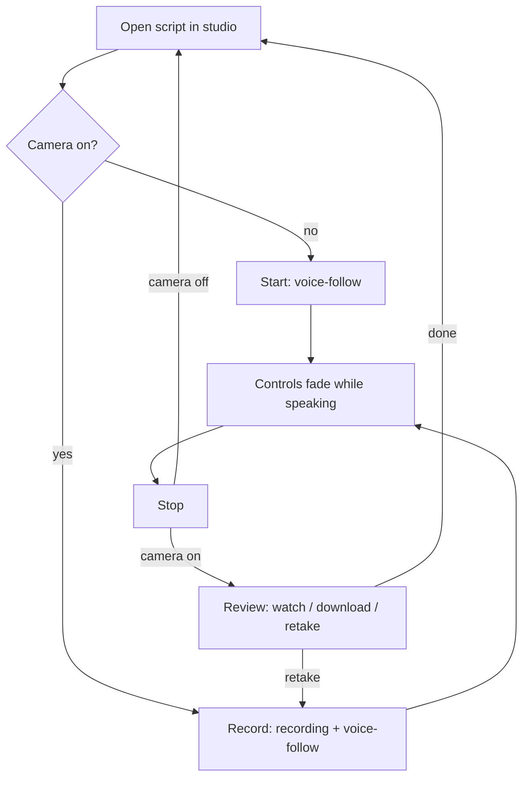

# First Take Clean Studio - Plan

## Goal Capsule

- **Objective:** A professional can open a script in First Take, press one button, and read it to camera while the text follows their voice, then download the take, with no controls to manage while they speak.
- **Means:** Improve the existing studio screen (`src/views/LivePrompterView.tsx`) in place: replace its timer scroll and decorative telemetry with real voice-follow and real recording, and remove controls that don't serve that job (KTD1, KTD2).
- **Product authority:** The app owner. Only the studio screen is active scope. The library, editor, sign-in, pricing, checkout, and landing page stay as they are.
- **Stop conditions:** Stop and ask if a change would require touching the library, editor, auth, or routing beyond the studio's existing props.
- **Execution profile:** One implementer, small diffs inside the existing app. No new app, no new framework.
- **Open blockers:** None.

---

## Product Contract

Product Contract preservation: changed: R1, R2, R12, and the "Cleanup, not rebuild" Key Decision — the GitHub code turned out to be the base, its studio has no working voice-follow or recording, and the owner chose to keep the library, editor, and sign-in untouched.

### Summary

The studio becomes one screen with one job: open a script, press Start (or Record with the camera on), and the text follows your voice. When you stop a recording you review it and download it. Controls fade while you speak. Settings shrink to font size, mirror, and light/dark.

### Problem Frame

First Take's promise is a teleprompter that listens. The studio in this codebase only looks like it does: it scrolls on a fixed timer, shows a decorative "Syncing Voice" label, a fake mic level and waveform, a stock photo in place of the camera, and a stop button that announces a saved video without recording anything. It also carries a speed slider, a reading-zone tag, a camera centerline, and a shortcut strip. A professional recording a pitch can't trust it, and every extra control is another thing to break mid-take.

### Actors

- A1. Professional presenter: founders, coaches, and teachers recording course videos, pitches, or LinkedIn clips at their desk.

### Key Decisions

- **Prompter first, recording second.** Voice-follow is the product; camera recording is an optional layer that can be switched off. (session-settled: user-directed — chosen over "record in the app as the core" and "prompter only": recording is wanted but must not complicate the core.) Governs R6, R7, R8.
- **One screen, one job.** Strip the studio to the single script-to-take flow. (session-settled: user-directed — chosen over a lean kit with WPM auto-scroll and over a rehearse-then-record flow: fewer features, each one solid.) Governs R3, R11, R12.
- **No fixed-speed auto-scroll.** When voice-follow can't run, the fallback is manual scrolling. Governs R5.
- **Improve the existing app, studio only.** Work happens inside the current studio screen; library, editor, sign-in, and pricing are untouched. (session-settled: user-directed — chosen over removing the library and sign-in, or keeping the library but dropping sign-in: the owner wants the rest of the app left as is.) Governs R1, R2.

### Requirements

**Script**

- R1. The studio shows whichever script the user opened from the library or editor, or the default script when opened from the landing page.
- R2. Script editing and saving stay in the existing editor and library; the studio does not edit scripts.

**Voice-follow prompter**

- R3. While the user speaks, the current line stays at a fixed reading position and the script advances as their words match it; it stops when they stop.
- R4. Pausing, ad-libbing, or briefly going off-script does not make the prompt jump ahead or lose its place, and it never moves backward on its own.
- R5. If voice-follow is unavailable (unsupported browser, microphone denied), the studio says so plainly and the user can scroll with arrow keys, Space, or by clicking a line.
- R13. Script cues in square brackets, such as `[PAUSE 2s]`, stay visible but are skipped by voice matching.

**Recording (optional)**

- R6. The user can turn the camera on or off; with it off, the studio is a pure voice-following prompter.
- R7. With the camera on, one Record control starts recording (camera and microphone) and voice-follow together, and Stop ends both.
- R8. After stopping, one review screen lets the user watch the take, download it, or discard it and record again from the top. Takes are not stored or listed.

**Distraction-free screen**

- R9. While voice-follow or recording is active, controls fade out after a short idle period, leaving the script and a small recording indicator.
- R10. Controls return when the user stops or moves the mouse.
- R11. Settings are limited to font size, mirror, and light/dark, reachable from one settings button and remembered between visits.
- R12. Removed from the studio: the speed slider and Slow/Fast labels, the Pause button, the fake mic-level pill, the WPM pill, the "Reading Zone" tag, the camera centerline, the "Syncing Voice" label, the fake waveform and "AUDIO OK", the stock-photo camera placeholder, and the always-visible shortcut strip.

### Key Flows

- F1. Record a take
  - **Trigger:** A1 opens a script in the studio with the camera on.
  - **Steps:** Press Record; read naturally while controls fade and the script follows; press Stop; watch the take; download it or retake.
  - **Outcome:** A downloaded video file of one take.
  - **Covered by:** R3, R7, R8, R9, R10
- F2. Prompter only
  - **Trigger:** A1 records in another tool and only needs the prompt.
  - **Steps:** Leave the camera off; press Start; read while the script follows; press Stop.
  - **Outcome:** The script was delivered without First Take capturing video.
  - **Covered by:** R3, R6, R9

### Acceptance Examples

- AE1. **Covers R3, R4.** **Given** voice-follow is active mid-script, **when** the user pauses for five seconds and then continues, **then** the prompt stays still during the pause and resumes from the same line.
- AE2. **Covers R4.** **Given** voice-follow is active, **when** the user ad-libs a sentence that isn't in the script, **then** the prompt doesn't skip forward and picks up again when they return to the script.
- AE3. **Covers R5.** **Given** the user denies microphone access or uses Firefox, **when** they press Start, **then** they see a short message that voice-follow is off and can still move through the script with arrow keys or Space.
- AE4. **Covers R8.** **Given** the user stops a recording, **when** they choose Retake, **then** the previous take is discarded and recording starts again from the top of the script.
- AE5. **Covers R9, R10.** **Given** recording is in progress, **when** the user moves the mouse, **then** controls reappear and fade again after a short idle period.
- AE6. **Covers R13.** **Given** the next text is `[PAUSE 2s]` followed by "Traditional software", **when** the user says "traditional software", **then** the prompt advances past the cue.

### Success Criteria

- The owner can record a 2-minute script in one take without touching a control mid-read, in Chrome and Edge.
- No control visible in the studio is decorative, broken, or unexplained.

### Scope Boundaries

**Deferred for later**

- Saved takes, a takes counter, or a recordings library.
- Fixed-speed (WPM) auto-scroll mode.
- Rehearse-then-record mode.
- Browser-extension version that floats the prompter over Zoom, Meet, or Loom.

**Outside this work**

- Library, editor, sign-in, cloud sync, pricing, checkout, and landing page.
- Cloud upload or storage of recordings. Recordings stay on the user's device.

### Dependencies / Assumptions

- Voice-follow relies on the browser's built-in speech recognition. Chrome and Edge support it; Safari support is best effort; Firefox has none and gets the manual fallback.
- In Chrome, speech recognition may send audio to Google's speech service unless on-device recognition is available for the language. The landing page's "on-device / nothing uploaded" claims may not hold everywhere.

### Sources / Research

- `src/views/LivePrompterView.tsx` — current studio: timer scroll (`speedLevel` effect), fake telemetry, `alert`-based stop, webcam with `audio: false`.
- `src/App.tsx` — renders the studio full-screen with `script`, `onExit`, `isPro` props; exit returns to the library.
- `src/data/defaultScripts.ts` — scripts contain bracketed cues such as `[PAUSE 2s]` and `[HOOK: 3-5 SECONDS]`.

---

## Planning Contract

### Key Technical Decisions

- KTD1. **Word-position matching against a forward window.** Voice-follow keeps a "next word" index into the script's spoken words (cues excluded). On each speech result, the last few heard words are compared against a limited window ahead of the current index; the index moves to the best match only when at least two consecutive words agree (one word if it is long and immediately next). No match means no movement, which satisfies R4. Rationale: simple, deterministic, testable without a microphone, and resistant to ad-libs.
- KTD2. **Browser APIs only, no new dependencies.** Speech uses the browser's `SpeechRecognition` / `webkitSpeechRecognition` in continuous, interim-results mode, restarted automatically when the browser ends a session while still active. Recording uses `getUserMedia` (video + audio) and `MediaRecorder`, choosing WebM where supported and MP4 otherwise. On-device recognition is requested only when the browser reports it available.
- KTD3. **Keep the studio's public props.** `LivePrompterView` keeps its `script`, `onExit`, `isPro` props so `src/App.tsx` and every other screen stay untouched.
- KTD4. **Matching logic in its own module.** The pure matcher lives in `src/lib/voiceFollow.ts` so it can be checked in isolation; the browser wiring lives in hooks next to it.

### Assumptions

- The repo has no test runner. The matcher is verified with a throwaway script during implementation rather than adding a test framework, to keep the change footprint inside the existing app; type-checking uses the existing `lint` script.

---

## Implementation Units

### U1. Voice-follow matcher

- **Goal:** Turn script text plus heard words into a reading position.
- **Requirements:** R3, R4, R13; KTD1, KTD4.
- **Dependencies:** none.
- **Files:** create `src/lib/voiceFollow.ts`.
- **Approach:**
  1. Split the script into paragraphs the same way the studio does today; tokenize each into words, marking bracketed cues as non-spoken.
  2. Normalize words (lowercase, strip punctuation).
  3. Provide an advance function implementing KTD1 that never returns an earlier position.
- **Test scenarios:**
  - Exact read of the first sentence advances the index to the end of that sentence.
  - Covers AE2. Ad-libbed words not in the script leave the index unchanged.
  - Covers AE6. Words after a bracketed cue match, skipping the cue.
  - A repeated phrase later in the script beyond the window does not cause a jump.
  - Re-saying earlier words does not move the index backward.
- **Verification:** The scenarios pass in a throwaway check run during implementation.

### U2. Speech and recording hooks

- **Goal:** Wrap browser speech recognition and media recording with clear support and error states.
- **Requirements:** R3, R5, R6, R7; KTD2.
- **Dependencies:** U1.
- **Files:** create `src/lib/useVoiceFollow.ts`, `src/lib/useRecorder.ts`.
- **Approach:** The speech hook exposes supported/listening/error state and feeds heard words to the matcher; it restarts after browser timeouts while active. The recorder hook manages the camera preview stream, starts/stops `MediaRecorder`, and returns a playable URL and file extension; it releases devices on unmount.
- **Test scenarios:** Manual in browser:
  - Covers AE3. Denying the microphone shows the fallback message and keeps manual scrolling working.
  - Recording for ten seconds produces a playable file with sound.
- **Verification:** Both hooks behave as above in Chrome.

### U3. Clean studio screen

- **Goal:** Rebuild the studio UI around one button, fading controls, and minimal settings.
- **Requirements:** R1, R5, R6, R7, R8, R9, R10, R11, R12; KTD3.
- **Dependencies:** U1, U2.
- **Files:** modify `src/views/LivePrompterView.tsx`.
- **Approach:**
  1. Remove the R12 elements and the timer-scroll effect.
  2. Header: script title, settings button, exit. Bottom dock: camera toggle and the Start/Record–Stop button.
  3. Highlight the paragraph holding the current word and dim words already read; keep it centered.
  4. Fade header and dock while active and idle (R9, R10).
  5. Review overlay after a recording stops (R8).
  6. Keyboard: Space/arrows move manually, R starts/stops, M mirrors, Esc exits (confirm only while recording).
  7. Persist font size, mirror, and dark mode in local storage.
- **Test scenarios:** Manual in browser:
  - Covers AE1. Pausing mid-script keeps the highlight in place.
  - Covers AE4. Retake discards the take and restarts recording from the top.
  - Covers AE5. Moving the mouse during recording brings controls back.
  - Settings survive a page reload.
- **Verification:** Studio shows no decorative elements; F1 and F2 work end to end in Chrome.

---

## Verification Contract

| Check | How |
|---|---|
| Types | `npm run lint` (runs `tsc --noEmit`) passes |
| Matcher | Throwaway check of U1 scenarios passes |
| Studio | `npm run dev`, open `/prompter`, walk F1 and F2 plus AE1–AE6 in Chrome |

## Definition of Done

- All R-IDs above hold in the running app in Chrome.
- `npm run lint` passes with no new errors.
- No other screen changed; no new runtime dependencies added.
- No leftover dead code from the old timer scroll or fake telemetry.
